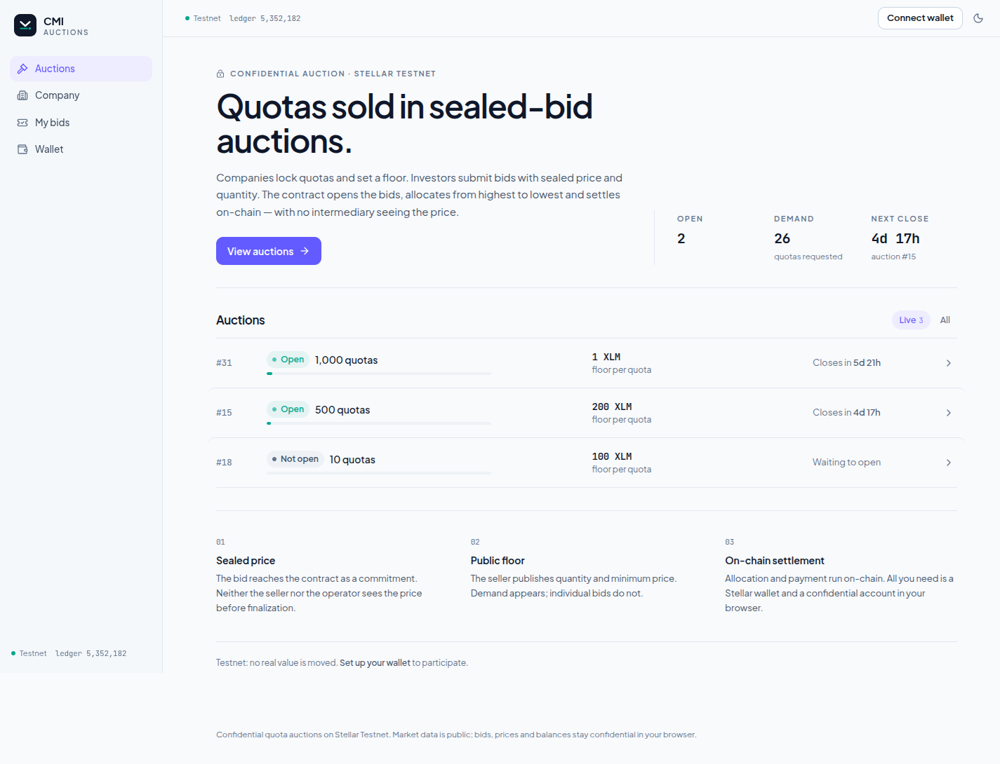

# CMI Auctions — Web app

> **Monorepo.** This project lives in `web/` in the CMI Auctions monorepo. The
> [root README](../README.md) covers the product and the full setup.

Web frontend for **CMI Auctions**: a confidential, multi-unit, pay-as-bid, sealed-bid quota
auction for tokenized RWAs on Stellar/Soroban. The price never leaves the browser in clear text;
ZK proofs are generated in the browser by the **SDK** ([`../sdk/`](../sdk/)).

**Demo:** <https://cmi-hackthon-meridian-web.vercel.app> — testnet, no real funds.



## What the app does

| Mode | Who uses it | What it does |
|---|---|---|
| **Company** | seller | registers the confidential account, creates the market, locks the quotas, tracks it, reads proceeds |
| **Investor** | bidder | registers the account, deposits XLM, places a sealed bid (two proofs in the browser), tracks it, recovers collateral |
| **Public** | no wallet | sees markets, demand, and state — never prices |

The **operator** (which closes, allocates, and settles) is the [`../operator/`](../operator/)
project; the app only shows progress from chain events. There is no backend of its own: the app
talks to testnet through the SDK, and the user's wallet signs.

- **Planning, architecture, screens, and tests:** [`docs/`](docs/README.md)
- **If you are going to develop:** [`CLAUDE.md`](CLAUDE.md) / [`AGENTS.md`](AGENTS.md) and the
  [`.claude/skills/cmi-front-tdd`](.claude/skills/cmi-front-tdd/SKILL.md) skill
- **Status:** [`docs/ROADMAP.md`](docs/ROADMAP.md) is the only source.

## Setup

### 1. Tools

| Tool | Version | For |
|---|---|---|
| Node | 22 (`.node-version`) | everything |
| pnpm | 10.34.6, via corepack (`corepack enable`) | the workspace |
| Playwright Chromium | 1.55.1 (`pnpm exec playwright install chromium`) | browser tests and E2E |
| Freighter (extension) | current | wallet, on **Testnet** |

No Docker or Rust needed to run the frontend: it uses testnet and the deployment that already
exists.

### 2. Clone and install

A monorepo clone already contains `web`, `sdk`, and `specs`; the links between them are versioned.

```bash
git clone --recurse-submodules https://github.com/devfelipenunes/CMI-hackthon-meridian.git cmi
cd cmi
./scripts/link-subprojects.sh   # no-op on a fresh clone; repairs the tree if needed
```

The frontend reads the SDK straight from the workspace, so install the SDK **first**:

```bash
cd sdk && pnpm install && pnpm test && cd ..
cd web && pnpm install
```

If the SDK does not pass `pnpm test`, the frontend will not pass either: fix that first (Node
version, `third_party` submodule).

### 3. Local configuration (`.env.local`)

```bash
cd web
cp .env.example .env.local
```

- `CMI_OPERATOR_SPENDER_KEY` / `CMI_REGISTER_DATA`: the operator's development key or the
  `register_data` it exports. Empty on the first run: `pnpm register-data` generates a development
  key and writes it here. **It never goes into git or the bundle.**
- `VITE_DEV_WALLET=1`: enables the development wallet. Tests only.

`.env.local` and `.local/` are gitignored.

### 4. Testnet

- **Platform deployment:** already exists; addresses are in
  [`app/public/config/testnet.json`](app/public/config/testnet.json) (factory, token, auditor,
  Auction WASM hash, VKs, `registerData`, `operatorKeyId`).
- **Accounts:** friendbot (`https://friendbot.stellar.org?addr=G…`), 10,000 XLM per account.
- **Freighter:** Settings → Network → **Testnet**.
- **RPC window:** the public RPC keeps ~7 days of events.
- **Operator:** without it running, markets stop at `Closed` and can be cancelled by timeout after
  the grace period. For the full auction, start [`operator/`](../operator/).

### 5. Commands

```bash
cd web
pnpm dev              # the app (Vite, http://localhost:5173)
pnpm lint             # eslint + dependency-cruiser + typecheck
pnpm test             # unit + flows + scripts (95 tests)
pnpm verify           # lint + test + build + bundle test
pnpm test:browser     # Chromium (proofs and IndexedDB)
pnpm sync:deployment  # testnet addresses → app/public/config/testnet.json
pnpm register-data    # operator register_data → config
pnpm fund             # create/fund dev wallets (.local/dev-wallets.json)
pnpm token:issue      # test quota token, no clawback
pnpm e2e              # Playwright; the public part needs no operator
```

**Dev wallet.** The button only appears in test builds: `VITE_DEV_WALLET=1 pnpm dev` (or
`VITE_DEV_WALLET=1 pnpm build`). The secret key is typed on screen and lives only in the tab's
memory; no key goes into the bundle.

**Config.** `testnet.json` is already filled in and checked against testnet. To regenerate it:
`pnpm sync:deployment && pnpm register-data`; `register-data` simulates a `create_market` before
writing.

## Rules for every commit

1. **TDD:** no production code without a failing test first ([`docs/TESTING.md`](docs/TESTING.md)).
2. **Only the SDK speaks the protocol.** No formula, hash, witness, or encoding in the frontend.
   The exception is classic Stellar operations the SDK does not cover (trustline, public XLM
   balance, friendbot), done with `@stellar/stellar-sdk` at the SDK's version (14.6.1).
3. **No secret leaks:** price, `price × qty`, keys, and openings never go into a URL,
   `localStorage`, logs, telemetry, error messages, serialized caches, or persisted global state.
   Price exists only in memory, during the bid.
4. **The `operator` package and `packages/testing` never enter the app bundle.** Lint and a bundle
   test enforce this.
5. **Values are `bigint`** (XLM in stroops, quotas in base units). `number` is only for counts,
   ledgers, and `bid_index`.
6. **The wallet signs.** The app never asks for or stores the user's Stellar key (except the
   development wallet).
7. **The bid order is the SDK's:** `prepareBid` (proofs, nothing locked) → confirmation →
   `placeBid` (`set_spender` → `submit_bid`).

## Branch flow

The frontend is on `main`. New work uses a short-lived feature branch and a PR to `main`, with a
test commit before the implementation commit.

```text
feature branch  ──PR──►  main
```

A change to the SDK is made **in `sdk/`**, with that project's `cmi-sdk-tdd` skill; the frontend
then uses the new behavior. `web/sdk` is a link to the single SDK copy in the monorepo — there is
no submodule pointer to update.

## Documentation

| Document | Contents |
|---|---|
| [`docs/ARCHITECTURE.md`](docs/ARCHITECTURE.md) | layers, folders, how the SDK enters the app, each user's flow |
| [`docs/SCREENS.md`](docs/SCREENS.md) | screens, states, and what each screen calls in the SDK |
| [`docs/TESTING.md`](docs/TESTING.md) | TDD strategy, SDK fakes, testnet E2E |
| [`docs/ROADMAP.md`](docs/ROADMAP.md) | the steps and the only source of status |
| [`docs/DECISIONS.md`](docs/DECISIONS.md) | frontend decisions (F-01..F-16) |
| [`docs/DEPLOYMENT.md`](docs/DEPLOYMENT.md) | Vercel deployment |
| [`docs/requests/`](docs/requests/) | this project's requests to the SDK |
